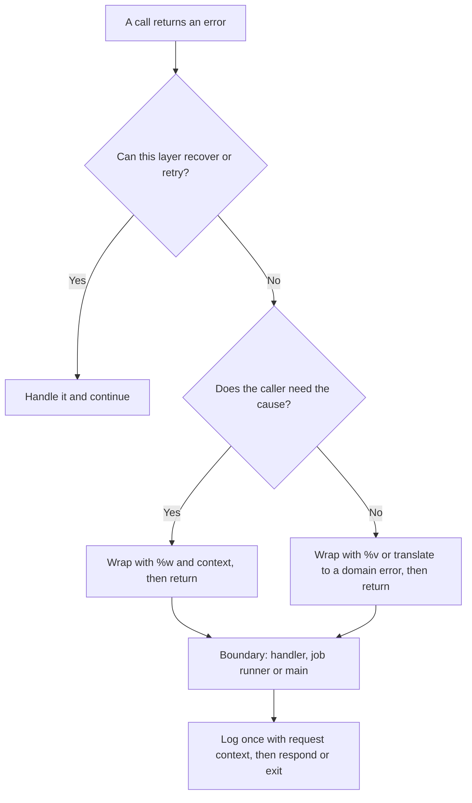

# Go Error Handling

- Responsibility: engineering
- Area/system: golang
- Keywords: errors, error wrapping, fmt.Errorf, %w, errors.Is, errors.As, errors.AsType, errors.Join, sentinel errors, custom error types, panic, handle errors once, errcheck, defer Close, log once, RFC 9457, problem details, application/problem+json, error response format
- Aliases: error handling Go, Go wrap error, Go sentinel error, Go custom error, panic vs error, penanganan error Go
- Status: active
- Last updated: 2026-10-26

Related notes: [named parameters and results](02-named-parameters-and-results.md), [package and API design](06-package-and-api-design.md), [concurrency and context](09-concurrency-and-context.md), [testing](10-testing.md), [service practices](11-service-practices.md).

## Summary

Check every error, add context where it helps, and handle each error once: either return it or deal with it, never both. Callers inspect errors with `errors.Is` and `errors.As`, not with string matching. Log at the boundary of the program.

## Rules

### Core rules

- **Check every error.** Handle it, return it or, in a truly exceptional case, panic. Never discard an error with `_` unless a comment says why that is safe. The `errcheck` linter enforces this.
- **Return `error` as the last result.** On failure, the other results are zero values unless the documentation says otherwise.
- **Handle each error once.** Either return it (with context) or handle it and log it. Doing both produces duplicate log lines and noise. Log at the boundary: the HTTP handler, the job runner or `main`.



### Creating and wrapping errors

- **Start messages in lower case and omit the final punctuation,** because errors are joined into chains: `fmt.Errorf("load config %q: %w", path, err)`.
- **Name the operation, not the failure.** Write `find user "u-1": ...`. Skip "failed to" and "error while": they state the obvious and pile up along the chain.
- **Put `%w` at the end** of the message: `"context: %w"`.
- **Choose `%w` or `%v` deliberately.** `%w` makes the cause part of your API, because callers can match it with `errors.Is` and `errors.As`. Use `%v` when you do not want to promise the underlying error, for example a driver's error type.
- **Return the original error unchanged** when you have no context to add. Do not repeat what the wrapped error already says (an `*fs.PathError` already carries the path).
- **Combine independent errors** with `errors.Join`, or with several `%w` verbs in one `fmt.Errorf` (Go 1.20+). Cleanup code is the usual place ([named parameters and results](02-named-parameters-and-results.md#deferred-closures)).
- **Do not wrap a pointer to an error type with `%w`.** From Go 1.27, `go vet` reports `fmt.Errorf("...: %w", p)` when `p` has type `*E` and `E` itself implements `error`, because it breaks `errors.Is` and type assertions.

### Inspecting errors

- Match a sentinel with `errors.Is(err, ErrNotFound)`. Extract a type with `errors.As` or, from Go 1.26, the generic `errors.AsType[*ValidationError](err)`, which is type-safe, faster and usually easier to use.
- Never compare wrapped errors with `==` and never match `err.Error()` text.
- Test for cancellation with `errors.Is(err, context.Canceled)` and `errors.Is(err, context.DeadlineExceeded)`. A cancelled request is usually not an error worth logging at error level.

### Designing errors for callers

- **Expose a sentinel error only for a condition that callers branch on,** and keep the set small. Sentinels are part of the API.
- **Declare a sentinel next to the code that returns it.** When several files of the package return the same one, move it to `errors.go`.
- **Use a custom type when callers need data** such as a field name or a code. Give it a pointer receiver and a name that ends in `Error`. Add `Unwrap() error` when it wraps another error.
- **Translate at package boundaries.** Map `sql.ErrNoRows` to the package's `ErrNotFound`, and wrap with `%w` only the third-party errors that you choose to promise.
- **Return a boolean instead of an error** only when no explanation is needed. Do not return `nil, nil` for "not found".

```go
var ErrNotFound = errors.New("not found")

func (s *Store) Find(ctx context.Context, id string) (user *User, err error) {
	row := s.db.QueryRowContext(ctx, `SELECT id, name FROM users WHERE id = ?`, id)
	user = &User{}
	if err = row.Scan(&user.ID, &user.Name); err != nil {
		if errors.Is(err, sql.ErrNoRows) {
			return nil, fmt.Errorf("find user %q: %w", id, ErrNotFound)
		}
		return nil, fmt.Errorf("find user %q: %w", id, err)
	}
	return user, nil
}
```

```go
type ValidationError struct {
	Field  string
	Reason string
}

func (e *ValidationError) Error() (message string) {
	return "invalid " + e.Field + ": " + e.Reason
}
```

### Panics and exits

- Use `panic` only for programmer errors and impossible states, and in `Must` helpers that run at start-up, such as `regexp.MustCompile` on a constant. Never use it for expected failures.
- Never let a panic cross a package boundary. `recover` only at a top-level boundary (HTTP middleware, a worker loop), and log the stack trace there.
- Call `os.Exit` and `log.Fatal` only in `main`. Deferred calls do not run after them ([project layout](04-project-layout.md#keep-main-thin)).

### Cleanup

- Put `defer` directly after the successful acquisition: `defer rows.Close()`, `defer cancel()`.
- Check the error from `Close` on files that you write. [Named parameters and results](02-named-parameters-and-results.md#deferred-closures) shows the pattern with `errors.Join`.
- Do not `defer` inside a long loop, because deferred calls run when the function returns. Move the loop body into its own function.

### Errors at the boundary

- Map errors to responses in one place (`problemFor` below). Log the internal detail on the server and return a client-safe message; never send an internal `err.Error()` to a caller ([service practices](11-service-practices.md#http-servers)).
- Return HTTP errors as RFC 9457 problem details: media type `application/problem+json` with `title`, `status` and `detail`. The `status` member repeats the HTTP status code. While `type` is absent, which means `about:blank`, `title` is the HTTP status phrase.
- Give a problem its own `type` URI only when a client has to tell apart two problems that share a status. A `tag:` URI works without hosting a page. Put extra data in extension members, which clients ignore when they do not know them.
- A body that an external specification defines follows that specification. BI SNAP, for example, carries `responseCode` and `responseMessage`.
- Existing projects keep their current error body. Never change a published body in place; introduce the new format with a new API version.

```go
// Problem is an RFC 9457 problem details body. Type stays empty, which means about:blank, until a client has to
// tell apart two problems that share a status.
type Problem struct {
	Type   string `json:"type,omitempty"`
	Title  string `json:"title"`
	Status int    `json:"status"`
	Detail string `json:"detail,omitempty"`
}

func newProblem(status int, detail string) (problem Problem) {
	return Problem{Title: http.StatusText(status), Status: status, Detail: detail}
}

// problemFor maps an error to a problem that is safe to show to the client, in one place.
func problemFor(err error) (problem Problem) {
	if invalid, ok := errors.AsType[*ValidationError](err); ok {
		return newProblem(http.StatusBadRequest, invalid.Error())
	}
	if errors.Is(err, ErrNotFound) {
		return newProblem(http.StatusNotFound, "")
	}
	return newProblem(http.StatusInternalServerError, "")
}

func writeProblem(w http.ResponseWriter, problem Problem) {
	w.Header().Set("Content-Type", "application/problem+json")
	w.WriteHeader(problem.Status)
	// the status line is already sent, so a failed write (the client went away) can only be dropped
	_ = json.NewEncoder(w).Encode(problem)
}
```

## Sources and raw notes

- [Go Code Review Comments](https://go.dev/wiki/CodeReviewComments): Handle Errors, Error Strings, Don't Panic, In-Band Errors.
- [Google Go Best Practices](https://google.github.io/styleguide/go/best-practices): Error handling, Adding information to errors, Placement of %w in errors, Logging errors.
- [Uber Go Style Guide](https://github.com/uber-go/guide/blob/master/style.md): Error Wrapping (avoid "failed to"), Handle Errors Once, Error Naming, Don't Panic, Exit in Main, Defer to Clean Up.
- [Working with errors in Go 1.13](https://go.dev/blog/go1.13-errors): wrapping, `Is` and `As`, and when wrapping exposes the cause.
- Release notes: [Go 1.20](https://go.dev/doc/go1.20) (`errors.Join`, several `%w`), [Go 1.26](https://go.dev/doc/go1.26) (`errors.AsType`), [Go 1.27](https://go.dev/doc/go1.27) (vet check for `%w` with a pointer).
- [RFC 9457, Problem Details for HTTP APIs](https://www.rfc-editor.org/rfc/rfc9457), read on 2026-10-26 (it obsoletes RFC 7807): the `application/problem+json` media type, the `type`, `title`, `status` and `detail` members, the `about:blank` default, and extension members.
- The code blocks compile and pass `go vet` and `go test -race` in a scratch module (Go 1.26.3): the first two on 2026-10-21, and the `Problem` block on 2026-10-26 with a test of three cases (a wrapped validation error, a wrapped `ErrNotFound` and an internal error whose detail stays hidden).
