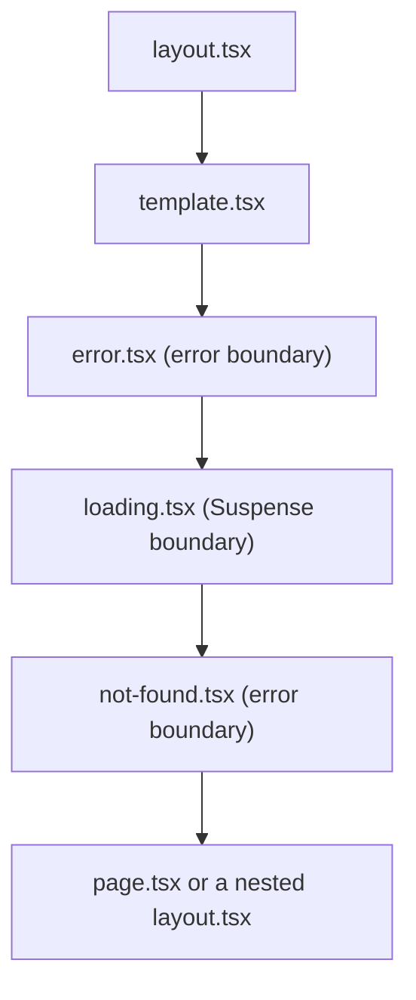

# Next.js Project Layout and Routing

- Responsibility: engineering
- Area/system: nextjs
- Keywords: project layout, folder structure, app directory, route groups, private folders, colocation, special files, page.tsx, layout.tsx, loading.tsx, error.tsx, not-found.tsx, route.ts, default.tsx, dynamic routes, params, PageProps, LayoutProps, RouteContext, next/link, redirects, rewrites, proxy.ts, middleware.ts, import alias, file naming, kebab-case, named exports, src folder
- Aliases: struktur folder Next.js, Next.js routing, Next.js app router layout, folder structure Next.js, penamaan file Next.js, route group Next.js
- Status: active
- Last updated: 2026-10-26

Related notes: [principles](01-principles-and-sources.md), [setup and tooling](02-project-setup-and-tooling.md), [Server and Client Components](04-server-and-client-components.md), [error handling and loading](07-error-handling-and-loading.md), [metadata and SEO](08-metadata-and-seo.md), [security](10-security.md).

## Summary

Next.js is unopinionated about where project files live, but it documents three strategies and asks teams to pick one and stay consistent. This convention keeps `app/` for routing only and puts shared code in `components/` and `lib/`. Route groups give different layouts to different routes, and `next/link` handles internal navigation.

## Rules

### Folder layout

```text
repo/
├── app/                  # routing only: layout, page, loading, error, route files
├── components/
│   ├── ui/               # generic building blocks
│   └── <feature>/        # one folder per feature or page group
├── lib/                  # non-UI code: data access, formatting, validation
├── public/               # static assets
├── next.config.ts
├── proxy.ts              # only when request-level logic is needed
├── eslint.config.mjs
├── tsconfig.json
└── package.json
```

- **Pick one strategy.** The docs list three: project files outside `app`, project files in top-level folders inside `app`, and files split by feature or route. Every project uses the first, because it is the most common in practice: Vercel's Commerce template and shadcn's Taxonomy put `components/` and `lib/` at the root. `app/` holds routes; shared code lives in `components/` and `lib/`. No project switches to a feature-split `app/` tree.
- **Skip `src/`.** `create-next-app` does not generate it by default, and the templates above do not use it.
- **Name modules by what they do.** Write `lib/currency.ts` or `lib/rich-text.ts`. Avoid catch-all folders such as `utils`, `helpers`, `common` and `misc`. Existing `services/` and `utils/` folders stay. A module moves to `lib/` when a change rewrites it.
- **Keep types beside their owner.** A `types.ts` next to the module replaces a global `interfaces/` folder.
- **Colocate with a private folder when a file belongs to one route only.** Use `app/<route>/_components/`. The underscore opts the folder out of routing.

### Routes and special files

| File | Purpose | Rule |
| --- | --- | --- |
| `layout.tsx` | Shared UI that keeps state across navigation | The root layout is required, holds `<html>` and `<body>`, and sets `lang` and fonts. |
| `page.tsx` | Makes a route public | Default export, Server Component. |
| `loading.tsx` | Suspense boundary for the segment | Optional. See [loading states](07-error-handling-and-loading.md#loading-states). |
| `error.tsx` | Error boundary for the segment | Client Component. Add one at the root. |
| `not-found.tsx` | 404 UI | Add one at the root and one beside each route that calls `notFound()`. |
| `global-error.tsx` | Fallback when the root layout fails | Add one. It defines its own `<html>` and `<body>`. |
| `route.ts` | HTTP endpoint | Only when a Route Handler is needed. It cannot share a segment with `page.tsx`. |
| `template.tsx` | Layout that re-renders on navigation | Rare. |
| `default.tsx` | Fallback for a parallel route slot | Required for every `@slot` since 16.0. |

The special files render in a fixed order, and each one wraps the next:



- `error.tsx` does not wrap the `layout.tsx` or `template.tsx` of its own segment. Only `global-error.tsx` catches a root layout failure.
- Use `[id]` for one parameter, `[...slug]` for a catch-all and `[[...slug]]` for an optional catch-all.
- Use parallel routes (`@slot`) and intercepting routes (`(.)folder`) only for slot and modal patterns.

### Route groups and private folders

- Use a route group `(name)` when different routes need different layouts. A group does not change the URL. Move the routes that share a layout into the group and give the group its own `layout.tsx`.
- Do not branch on `usePathname()` inside a client layout to hide a header or footer. A route group does the same job on the server and keeps the layout a Server Component.

```text
app/
├── layout.tsx            # <html lang>, fonts, analytics
├── (site)/
│   ├── layout.tsx        # header and footer
│   ├── page.tsx          # /
│   └── faq/page.tsx      # /faq
└── (standalone)/
    ├── layout.tsx        # no header or footer
    └── landing/page.tsx  # /landing
```

```tsx
// app/(site)/layout.tsx
import { Footer } from '@/components/site/footer'
import { Header } from '@/components/site/header'

export default function SiteLayout({ children }: { children: React.ReactNode }) {
  return (
    <>
      <Header />
      <main>{children}</main>
      <Footer />
    </>
  )
}
```

- A route group at the top level without a root `layout.tsx` creates several root layouts. Each then needs its own `<html>` and `<body>`. Use that only for sections that differ completely.

### Naming

- **Route folders:** lower-case kebab-case. A URL slug is public API. Keeping slugs in the audience's language is fine when it is deliberate (for example `/kontak` on a site written in Indonesian). Add a redirect when a slug changes.
- **Other files:** kebab-case (`header-nav-bar.tsx`), as the official examples, Vercel's Commerce template and shadcn's templates do. Components use PascalCase identifiers, functions and hooks use camelCase. The default macOS file system ignores case, so a wrongly cased import works locally and fails on Linux CI. One lower-case style avoids that class of bug.
- **Existing files:** keep their names. Rename a file only in a dedicated rename change, such as one that fixes a typo in a file name.
- **Exports:** special files use default exports because Next.js requires them. Every other module uses named exports. A module that already has a default export keeps it until a change rewrites the module.
- **Hooks:** `use-media-query.ts` exports `useMediaQuery`.

### Props and params

- `params` is a Promise. Write `const { id } = await props.params`. Synchronous access was removed in 16.0.
- `searchParams` exists only on `page`. Layouts do not receive it.
- Type the props with the global helpers, which `next dev`, `next build` and `next typegen` generate:

```tsx
export default async function Page(props: PageProps<'/career/detail/[id]'>) {
  const { id } = await props.params
  // ...
}
```

- Use `LayoutProps<'/route'>` for layouts and `RouteContext<'/users/[id]'>` for Route Handlers.
- Treat `params` and `searchParams` as user input and validate them before use.

### Navigation and redirects

- Use `<Link>` for internal navigation. It prefetches and navigates on the client. Use `<a>` for external links, with `rel="noopener noreferrer"` when it opens a new tab.
- Use `useRouter` only for navigation that an event triggers, never for a plain link.
- Use `redirect()` and `permanentRedirect()` in server code, and `notFound()` for a missing resource.
- Put static redirects and rewrites in `redirects()` and `rewrites()` in `next.config.ts`. They match path, header, cookie, query and host (`has` and `missing`). `permanent: true` sends 308, and `false` sends 307.

### Proxy

- Since 16.0 the file is `proxy.ts`, and the exported function is `proxy`. `middleware.ts` is deprecated. `proxy` always runs on the Node.js runtime, so keep `middleware.ts` only if you need the Edge runtime.
- Keep one `proxy.ts` per project, at the project root beside `app/`. Split logic into modules and import them.
- Narrow it with `config.matcher` instead of testing the path inside the function.
- Reach for `proxy.ts` only when you need request data or logic that `redirects()` and `rewrites()` cannot express. The docs say to try the config first.
- It is not for slow data fetching, and it is not an authorisation layer ([security](10-security.md#proxy-is-not-an-authorisation-layer)).

### Imports

- Import from outside the current feature folder with the `@/` alias. Use relative imports only for a sibling or a direct child (`./`), and avoid `../../..`.
- Do not import a Server Component into a `'use client'` file. Pass it as `children` instead ([composition](04-server-and-client-components.md#composition)).

## Sources and raw notes

Pages read on 2026-10-26:

- [Project structure and organization](https://nextjs.org/docs/app/getting-started/project-structure): folder and file conventions, three organisation strategies, route groups, private folders, component hierarchy.
- [Layouts and pages](https://nextjs.org/docs/app/getting-started/layouts-and-pages): nested routes, `searchParams`, `PageProps` and `LayoutProps`.
- [Route Handlers](https://nextjs.org/docs/app/getting-started/route-handlers) (`RouteContext`, `route.ts` versus `page.tsx`) and [Proxy](https://nextjs.org/docs/app/getting-started/proxy).
- [`redirects`](https://nextjs.org/docs/app/api-reference/config/next-config-js/redirects): `has` and `missing` with `header`, `cookie`, `host` and `query`.
- [Upgrading to version 16](https://nextjs.org/docs/app/guides/upgrading/version-16): `default.js` requirement, async request APIs, `middleware` to `proxy`.
- [`error.js`](https://nextjs.org/docs/app/api-reference/file-conventions/error): what the boundary wraps.
- GitHub API listings on 2026-10-26: `vercel/commerce` (root `app`, `components`, `lib`, `fonts`; kebab-case files such as `components/cart/add-to-cart.tsx`; no `src/`), `shadcn-ui/taxonomy` (root `app`, `components`, `config`, `hooks`, `lib`; kebab-case files) and the `create-next-app` `app-tw/ts` template (`app/` and `public/` only).
