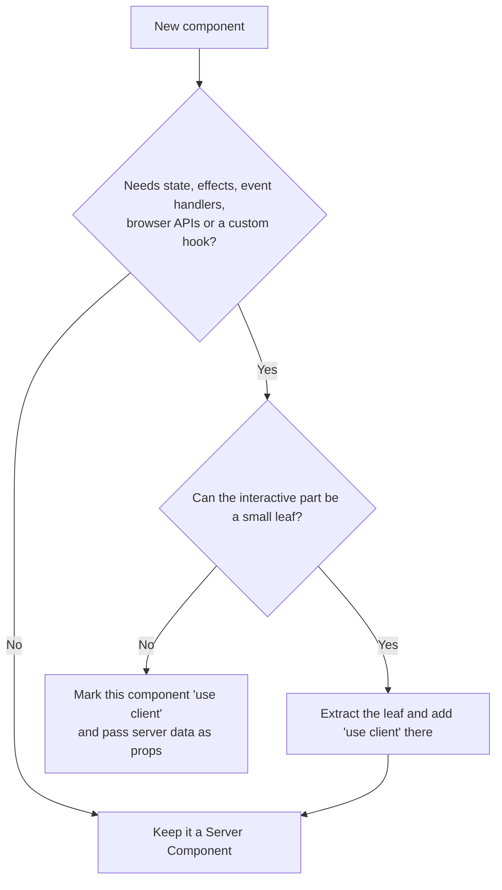

# Next.js Server and Client Components

- Responsibility: engineering
- Area/system: nextjs
- Keywords: Server Components, Client Components, use client, server-only, client-only, RSC payload, hydration, composition, children slot, context provider, third-party components, next/dynamic, lazy loading, ssr false, useSearchParams, usePathname, Suspense, serialisable props, DTO, async client component
- Aliases: RSC, React Server Components, server component vs client component, kapan pakai use client, komponen server dan client, boundary use client, ClientLayout
- Status: active
- Last updated: 2026-10-26

Related notes: [principles](01-principles-and-sources.md), [layout and routing](03-project-layout-and-routing.md), [data fetching and caching](05-data-fetching-and-caching.md), [security](10-security.md).

## Summary

Components are Server Components by default. A file becomes a Client Component only when it starts with `'use client'`, and everything that file imports joins the client bundle. Keep the boundary small, push it to the leaves, and pass server data down as serialisable props.

## Rules

### Choosing the environment

Use a Client Component only when the component needs one of these:

- state or event handlers (`onClick`, `onChange`);
- lifecycle logic (`useEffect`);
- browser-only APIs (`localStorage`, `window`, `navigator`);
- a custom hook that uses any of the above.

Use a Server Component to fetch data close to the source, to use secrets without exposing them, to send less JavaScript and to stream HTML sooner.



### Placing the boundary

- `'use client'` marks the border between the server module graph and the client module graph. The file, everything it imports and every component it renders directly go into the client bundle. Children need no directive of their own.
- Keep `layout.tsx` and `page.tsx` Server Components.
- Do not wrap the whole app in one `'use client'` component (a `ClientLayout`, for example) just to call a hook. Extract the part that needs the hook.
- Extract the interactive leaf. A layout with a static logo and a search box keeps `Logo` on the server and marks only `Search` as a Client Component.
- Name a leaf for what it does (`search-box.tsx`). A `client` suffix adds nothing.

### Composition

- Pass Server Components to a Client Component as `children` or as another prop. They render on the server first, and the Client Component only places their output.

```tsx
// page.tsx (Server Component)
<Modal>
  <Cart />
</Modal>
```

- Do not import a Server Component into a `'use client'` file. The import pulls it into the client bundle, where async and server-only code breaks. Pass it as `children` instead.

### Providers

- React context does not work in Server Components. Create a Client Component that accepts `children` and renders the provider.
- Render a provider as deep as possible. Wrap `{children}`, not `<html>`, so Next.js can optimise the static parts.

### Props across the boundary

- Props must be serialisable by React. Functions and class instances cannot cross, except Server Functions.
- Pass the minimum: a DTO with the fields the component renders. Never pass a raw database or CMS record ([data access layer](10-security.md#data-access-layer)).
- To stream data, start the promise in the Server Component without `await`, pass it down, and read it with `use()` in a Client Component inside `<Suspense>`.

### Third-party components

- A package that uses state or effects but lacks `'use client'` fails in a Server Component. Wrap it once in your own client module and import the wrapper.

```tsx
// components/ui/carousel.tsx
'use client'

export { Carousel } from 'acme-carousel'
```

- Library authors add `'use client'` to the entry points that need it, so consumers need no wrapper.

### Server-only and client-only code

- Put `import 'server-only'` in every module that touches secrets, databases or private APIs. A client import then fails at build time. Use `import 'client-only'` for modules that read `window`.
- Next.js handles both imports itself, so the npm packages are optional. Install them when the linter flags the import as extraneous.
- Only variables that start with `NEXT_PUBLIC_` reach the browser. Next.js replaces all other `process.env` reads in client code with an empty string.

### Lazy loading

- Use `next/dynamic` (or `React.lazy` with `<Suspense>`) for heavy client-only code that the first paint does not need: modals, carousels, charts, editors.
- `ssr: false` works only inside a Client Component. In a Server Component it is an error.
- Load a large library on demand with `await import('library')` inside an event handler.
- Do not lazy-load the largest element above the fold.

### Memoisation

- Do not add `useMemo`, `useCallback` or `React.memo` without a profiler result that shows a render problem. The React Compiler is off ([configuration](02-project-setup-and-tooling.md#configuration)).

### Search parameters and the pathname

- In a page, read `searchParams` from the props and pass the values down. Use `useSearchParams` only to filter data that the client already holds.
- A static route that calls `useSearchParams` in a Client Component must wrap that component in `<Suspense>`. Without it `next build` fails with "Missing Suspense boundary with useSearchParams". `next dev` hides the problem, so always run `next build`.
- Do not use `usePathname()` to switch layouts. Use a [route group](03-project-layout-and-routing.md#route-groups-and-private-folders).
- Do not write `async` Client Components. The ESLint rule `@next/next/no-async-client-component` blocks them.

## Sources and raw notes

Pages read on 2026-10-26:

- [Server and Client Components](https://nextjs.org/docs/app/getting-started/server-and-client-components): when to use each, boundary, composition, providers, third-party components, `server-only`.
- [Lazy loading](https://nextjs.org/docs/app/guides/lazy-loading): `next/dynamic`, `ssr: false` restriction.
- [`useSearchParams`](https://nextjs.org/docs/app/api-reference/functions/use-search-params): Suspense requirement in prerendered routes.
- [ESLint plugin](https://nextjs.org/docs/app/api-reference/config/eslint): rule list, including `no-async-client-component`.
- [Fetching data](https://nextjs.org/docs/app/getting-started/fetching-data): streaming data with the `use` API.
