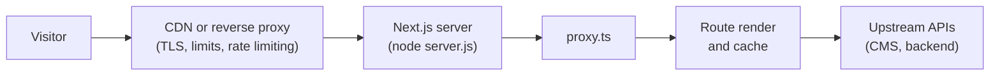

# Next.js Deployment and Self-Hosting

## Summary

Ship a Next.js app as a Docker image built from `output: 'standalone'`, run it as a non-root user behind a reverse proxy, and build the image once for every environment. Several instances need a shared cache handler, one Server Actions encryption key and a deployment identifier.

## Rules

### Hosting model

- Self-host with `next start`, or with the Docker image from the standalone build. The build traces the files that the app needs and writes `.next/standalone/server.js`, a minimal server that replaces `next start`. The image needs no `node_modules` install.
- A static export (`output: 'export'`) cannot use `proxy.ts` or other request-time features. Choose it only for a site that uses none of them.
- Hosting platforms integrate through the stable Adapter API (since 16.2). Self-hosting needs no adapter.

### Docker

- Use a multi-stage build like the official `with-docker` example: `dependencies` (`npm ci`), `builder` (`npm run build`) and `runner`.
- The standalone folder does not contain `public/` or `.next/static`. Copy both into the runner stage, or serve them from a CDN.
- In the runner stage set `NODE_ENV=production`, `PORT` and `HOSTNAME=0.0.0.0`, run as a non-root user and start `node server.js`.
- Pin the Node.js major to an LTS line (24 on 2026-10-26) and refresh the patch version on a schedule. The official example asks you to update its version argument to the latest LTS regularly.
- New projects use the Debian slim image (`node:<major>-slim`), as the official example does. Existing Alpine images stay until a native-module problem forces a change. On a glibc image, image optimisation may need the memory allocator set-up that the Next.js self-hosting guide links to.
- Add a `.dockerignore` with `.git`, `node_modules`, `.next` and `.env*`, so that `COPY . .` does not send them into the build.
- Build the image once and promote it. `NEXT_PUBLIC_*` values are fixed at build time ([environment variables at runtime](#environment-variables-at-runtime)).

```dockerfile
# An LTS line; refresh the patch version on a schedule.
ARG NODE_VERSION=24-slim

FROM node:${NODE_VERSION} AS runner
WORKDIR /app
ENV NODE_ENV=production PORT=3000 HOSTNAME=0.0.0.0

COPY --from=builder --chown=node:node /app/public ./public
RUN mkdir .next && chown node:node .next
COPY --from=builder --chown=node:node /app/.next/standalone ./
COPY --from=builder --chown=node:node /app/.next/static ./.next/static

USER node
EXPOSE 3000
CMD ["node", "server.js"]
```

### Reverse proxy

- Put nginx or a similar proxy in front of the server. It handles malformed requests, slow-connection attacks, payload limits and rate limiting, so that Next.js spends its time on rendering.
- Hide the server version. On Apache, use `ServerTokens Prod` and `ServerSignature Off`. Check the response headers of the deployed site to confirm it.
- Streaming needs unbuffered responses. For nginx, send `X-Accel-Buffering: no` from `headers()` in `next.config.ts`. Every proxy and load balancer between the visitor and the server (Apache included) must pass chunked responses through. Confirm it once with a route that has a delayed `<Suspense>` fallback.
- Forward the original `Host` (or `X-Forwarded-Host`), or list the public host in `serverActions.allowedOrigins`. Otherwise the Server Actions origin check rejects the request.
- A CDN caches only what the response allows. Pages that read request-time data send `Cache-Control: private`, and fully static pages send `public`.



### Environment variables at runtime

- Server variables are read at run time. `NEXT_PUBLIC_*` variables are inlined at build time and stay fixed in the image.
- When the browser needs a per-environment value, read it on the server after `await connection()` (or another request-time API) and pass it down, or serve it from your own endpoint.
- Give the container its variables through the orchestrator or an `env_file`. Never bake a secret into an image layer, a build argument or a `COPY`.

### Several instances

- Run one instance. The website's Compose file defines a single service. A second instance needs everything below first.
- The default cache is memory (50 MB by default) plus local disk, **per instance**. Each pod or container keeps its own copy. With several instances, set `cacheHandler` to a shared store such as Redis, and set `cacheMaxMemorySize: 0` to switch off the in-memory copy.
- `revalidateTag` only invalidates the instance that ran it, unless the handler implements `refreshTags()` against shared storage.
- Build once and run the same build everywhere. When you must rebuild per environment, return the same value from `generateBuildId`.
- Give the build one `NEXT_SERVER_ACTIONS_ENCRYPTION_KEY`, so that every instance can decrypt what another one encrypted. Otherwise Server Actions fail with "Failed to find Server Action".
- Set `deploymentId` so that Next.js detects version skew during rolling deployments and falls back to a full page load.

### Shutdown and health

- Stop the container with SIGTERM or SIGINT. Next.js finishes in-flight requests and the pending `after()` callbacks before it exits. Allow a drain period of 10 to 30 seconds.
- Give the image a `HEALTHCHECK` that requests the container's own port on `127.0.0.1`. That works because the server listens on `0.0.0.0`. A health endpoint is a Route Handler, and a GET handler is not cached, so it runs on every request.
- Remove Apache files such as `.htaccess`. They do not apply to a Node.js server.

## Sources and raw notes

Pages read on 2026-10-26:

- [Self-hosting](https://nextjs.org/docs/app/guides/self-hosting): reverse proxy, image optimisation, caching and ISR, cache handler, build cache, multi-server notes, version skew, streaming, `after`, graceful shutdown.
- [`output`](https://nextjs.org/docs/app/api-reference/config/next-config-js/output): standalone folder, copying `public` and `.next/static`, `PORT` and `HOSTNAME`.
- The official [`with-docker` Dockerfile](https://github.com/vercel/next.js/blob/canary/examples/with-docker/Dockerfile) (canary branch): stages, `HOSTNAME`, non-root user, Node.js version note.
- [Data security](https://nextjs.org/docs/app/guides/data-security) (encryption key, allowed origins) and [Environment variables](https://nextjs.org/docs/app/guides/environment-variables) (runtime reads).
- [Next.js 16.2](https://nextjs.org/blog/next-16-2): stable Adapters. [October 2026 security update](https://nextjs.org/blog/nextjs-security-update-october-14-2026): glibc condition.
- Node.js [release schedule](https://github.com/nodejs/Release/blob/main/schedule.json): v24 in Maintenance LTS since 2026-10-20.
