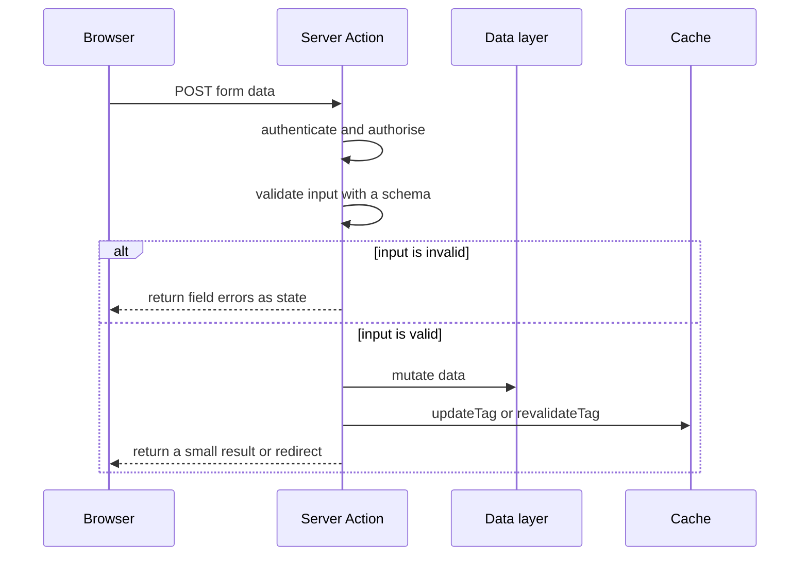

# Next.js Mutations and Forms

## Summary

Mutate data through Server Functions. Each one is a public POST endpoint, so it authenticates, authorises and validates its own input, returns expected errors as values, updates the cache, and then redirects. Forms use `<form action>` so that they work before hydration.

## Rules

### Server Functions

- Write mutations as async functions with the `'use server'` directive, and call them from `<form action>` or from event handlers. Next.js sends them as POST requests.
- Keep actions in an `actions.ts` file that starts with `'use server'`, beside the route that uses it. Keep each action thin: authenticate, validate, call the `server-only` data layer, update the cache. Business logic lives in the data layer ([security](10-security.md#data-access-layer)).
- Treat every exported action as a public endpoint that anyone can POST to directly. Authenticate and authorise inside the action, even when the form only renders on a protected page. Check that the user owns the resource, not only that the user is logged in.
- Anonymous forms (contact, complaint, whistleblowing) skip authentication. Validation, rate limiting and bot protection still apply.
- The client sends actions one at a time. Do not use an action to read data in parallel. Fetch in Server Components instead.

### Forms

- Prefer `<form action={fn}>`. The form works before JavaScript loads (progressive enhancement), and the action receives `FormData`.
- Pass an extra argument with `fn.bind(null, value)`. A hidden input puts the value in the rendered HTML.
- Turn the form into a Client Component only when you need `useActionState`, `useFormStatus` or `useOptimistic`. Keep the markup of that component small.

### Validation and errors

- Validate on the server with a Zod schema ([runtime validation](../typescript-conventions/05-runtime-validation-and-external-data.md#forms-and-user-input)). HTML attributes (`required`, `type="email"`) only help the user.
- Return expected errors (invalid input, a rejected upstream call) as values and read them with `useActionState`. Throw only for unexpected errors, which reach the nearest `error.tsx` ([error handling](07-error-handling-and-loading.md)).
- Show messages in an element with `aria-live="polite"`.
- Show the pending state with the `pending` value of `useActionState`, or with `useFormStatus` in a child button. Use `useOptimistic` for optimistic updates and `useTransition` when an event handler calls an action.

```ts
// app/contact/actions.ts
'use server'

import { z } from 'zod'
import { saveContactRequest } from '@/lib/contact'
import { contactSchema } from '@/lib/contact-schema' // a Zod schema

export interface ContactState {
  errors?: Record<string, string[] | undefined>
  sent?: boolean
}

export async function sendContact(
  previousState: ContactState,
  formData: FormData
): Promise<ContactState> {
  const parsed = contactSchema.safeParse(Object.fromEntries(formData))
  if (!parsed.success) {
    return { errors: z.flattenError(parsed.error).fieldErrors }
  }

  await saveContactRequest(parsed.data) // server-only data layer, rate limited
  return { sent: true }
}
```

```tsx
// app/contact/contact-form.tsx
'use client'

import { useActionState } from 'react'
import { sendContact, type ContactState } from './actions'

const initialState: ContactState = {}

export function ContactForm() {
  const [state, formAction, pending] = useActionState(sendContact, initialState)

  return (
    <form action={formAction}>
      <input name="email" type="email" required />
      <p aria-live="polite">{state.errors?.email?.[0]}</p>
      <button disabled={pending}>Send</button>
    </form>
  )
}
```



### After the mutation

- Update cached data before you redirect: `updateTag` when the user must see their change at once, `revalidateTag(tag, 'max')` when a short delay is fine, `revalidatePath` when you have no tag, and `refresh()` for uncached UI ([revalidation](05-data-fetching-and-caching.md#caching-and-revalidation)).
- `redirect()` throws a control-flow exception, so call it last. Nothing after it runs.
- Setting or deleting a cookie in an action makes Next.js re-render the current page and its layouts on the server.

### Return values and abuse

- Return only what the UI needs (`{ sent: true }` or field errors), never a raw record.
- A public form calls its backend from a Server Action, so the backend address and the Turnstile secret stay on the server. The backend stays the enforcement point: it validates the schema, verifies the token and rate-limits callers.
- Verify a Cloudflare Turnstile token on the server for every public form. The website's security notes name Turnstile first.
- Rate limiting lives at the reverse proxy (per IP) and in the backend that owns the endpoint. The Next.js app keeps no limiter of its own.
- Behind a reverse proxy with a different public host, set `serverActions.allowedOrigins`. With several instances, give every instance the same `NEXT_SERVER_ACTIONS_ENCRYPTION_KEY` ([security](10-security.md#server-functions), [deployment](12-deployment-and-self-hosting.md#several-instances)).
- Never trigger a mutation during rendering, for example by logging a user out when a `searchParams` flag is set. Next.js blocks cookie writes and cache revalidation in render, and a form with an action is the right tool.

## Sources and raw notes

Pages read on 2026-10-26:

- [Mutating data](https://nextjs.org/docs/app/getting-started/mutating-data): Server Functions and Actions, forms, pending state, refresh, revalidate, redirect, cookies.
- [Forms](https://nextjs.org/docs/app/guides/forms): `bind`, validation with Zod or Valibot, `useActionState`, `useFormStatus`, `useOptimistic`.
- [Data security](https://nextjs.org/docs/app/guides/data-security): actions as POST endpoints, authentication and authorisation inside actions, return values, rate limiting, allowed origins, side effects in render.
- [Error handling](https://nextjs.org/docs/app/getting-started/error-handling): expected errors as return values.
- [`updateTag`](https://nextjs.org/docs/app/api-reference/functions/updateTag): works with `fetch` tags, Server Actions only.
- The CMS download endpoint needs schema validation, rate limiting and a CAPTCHA.
