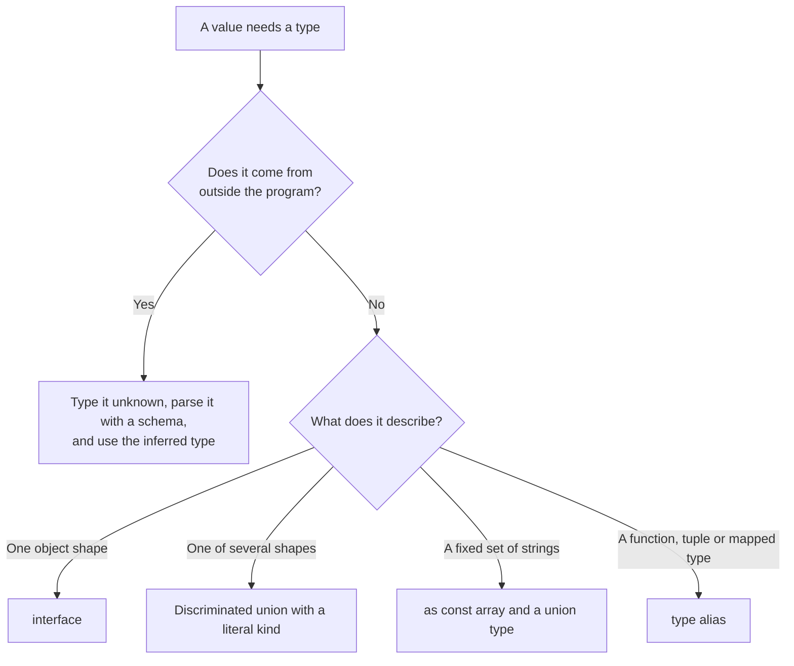

# TypeScript Types and Type Design

- Responsibility: engineering
- Area/system: typescript
- Keywords: any, unknown, interface, type alias, union type, discriminated union, exhaustive switch, assertNever, satisfies, as const, readonly, enum alternative, string literal union, null, undefined, optional property, type assertion, non-null assertion, type predicate, generics, utility types, conditional types, mapped types, money, minor units, decimal.js, Date, Temporal, Intl.NumberFormat
- Aliases: tipe TypeScript, TypeScript type design, interface vs type, avoid any, hindari any, discriminated union, pengganti enum, TypeScript generics guidelines, uang di TypeScript, type safety
- Status: active
- Last updated: 2026-10-26

Related notes: [principles](01-principles-and-sources.md), [tsconfig](03-tsconfig.md), [runtime validation](05-runtime-validation-and-external-data.md), [error handling](09-error-handling.md), [testing](10-testing.md), [TypeScript in React](11-typescript-in-react.md).

## Summary

Describe values with the narrowest type that is true. Use `unknown` for data of unknown shape, `interface` for object shapes, unions instead of `enum` and flags, and derive a type from its source instead of copying it. Keep assertions and type-level cleverness for the few cases that need them.

## Rules



### Use unknown, not any

- Type a value of unknown shape as `unknown`, and narrow it with `typeof`, `instanceof`, `in`, a type guard or a schema. `any` switches the checker off for everything that it touches.
- Do not write `any`. The `recommended` preset reports it as an error (`no-explicit-any`). When it is unavoidable, such as a partial mock in a test, disable the rule on that line and say why in the same comment.
- Assign the result of `JSON.parse`, `response.json()` and `Object.fromEntries(formData)` to an `unknown` variable at once, and validate it ([runtime validation](05-runtime-validation-and-external-data.md)).
- Do not use `{}`, `Object`, `Function`, `String`, `Number` or `Boolean` as types. Use `unknown`, `object`, `Record<string, T>`, a function signature or the lowercase primitive. The `recommended` preset reports all of them.
- Existing code: replace `any` in the lines you change.

```ts
export function isRecord(value: unknown): value is Record<string, unknown> {
  return typeof value === "object" && value !== null && !Array.isArray(value);
}

export function readMessage(error: unknown): string {
  if (error instanceof Error) return error.message;
  if (isRecord(error) && typeof error.message === "string") return error.message;
  return String(error);
}
```

### Describe shapes with interface

- Declare an object shape with `interface`, and use `extends` to build on it. The `stylistic` preset enforces this (`consistent-type-definitions`), and so does the Google guide.
- Use `type` for unions, intersections, tuples, function types, mapped and conditional types, and names for primitives.
- Give a property or a parameter that may be absent the `?` modifier, not `| undefined`. Never put `| null` or `| undefined` inside a type alias, and add it where the alias is used.
- Annotate an object literal with its type, or use `satisfies`, instead of writing `as Foo`. An annotation reports a field that no longer exists, and `as` hides it.
- Write `T[]` and `readonly T[]`, never `Array<T>` (`array-type`). Omit an annotation that inference already knows (`no-inferrable-types`).
- Existing code: the `stylistic` preset reports object-shaped type aliases, so convert them in the lines you change.

### Derive types, do not copy them

- Derive a union from a constant with `as const`, and check a lookup table with `satisfies`, so that adding a status without a label fails the build.
- Derive a type from a schema (`z.infer`), from a function (`ReturnType`, `Parameters`, `Awaited`) or from a value (`typeof`) instead of declaring it twice.
- Use the built-in utility types (`Pick`, `Omit`, `Partial`, `Required`, `Readonly`, `Record`, `NonNullable`, `Extract`, `Exclude`, `NoInfer`) before you write a mapped type.

```ts
export const LOAN_STATUSES = ["pending", "paid", "overdue"] as const;

export type LoanStatus = (typeof LOAN_STATUSES)[number];

export interface Loan {
  id: string;
  amountMinor: number;
  status: LoanStatus;
  note?: string;
}

// satisfies checks that every status has a label and keeps the literal types.
export const STATUS_LABELS = {
  pending: "Menunggu",
  paid: "Lunas",
  overdue: "Terlambat",
} satisfies Record<LoanStatus, string>;
```

### Model alternatives with unions

- Write a discriminated union with a literal `kind` property, and handle it with a `switch` whose `default` branch calls `assertNever`. Adding a variant then fails the build at every `switch` that misses it.
- Do not declare an `enum`. Use a union of string literals that you derive from an `as const` array. An `enum` generates run-time code, which `erasableSyntaxOnly` rejects and Node.js type stripping refuses to run. A string union also serialises as itself.
- Return a `Result` union when failure is a normal outcome ([error handling](09-error-handling.md#expected-failures)).

```ts
export type PaymentResult =
  | { kind: "paid"; paidAt: string }
  | { kind: "failed"; reason: string }
  | { kind: "pending" };

function assertNever(value: never): never {
  throw new Error(`Unexpected value: ${JSON.stringify(value)}`);
}

export function describePayment(result: PaymentResult): string {
  switch (result.kind) {
    case "paid":
      return `Paid at ${result.paidAt}`;
    case "failed":
      return `Failed: ${result.reason}`;
    case "pending":
      return "Waiting for payment";
    default:
      return assertNever(result);
  }
}
```

### null and undefined

- Use `undefined` for an absent value in your own code: optional properties, `Map.get`, `Array.prototype.find`. Use `null` for an explicit "no value" that crosses a boundary: JSON, SQL `NULL`, DOM APIs, and the initial value of React state or a ref.
- Do not use both for one field. Convert at the boundary, for example by mapping a nullable column to an optional property when the schema parses it.
- Compare with `===` and `!==`. The one exception is `value == null`, which tests for both.
- Prefer `??` and `?.` to `||` and `&&` chains (`prefer-nullish-coalescing`, `prefer-optional-chain`).

### Assertions

- Do not use `as` to silence the compiler. Narrow with a type guard, a schema or a check, and let the compiler follow.
- `as const` and `satisfies` are fine. Use `as unknown as T` only for a test double, with a comment ([testing](10-testing.md#test-doubles)).
- Never use the non-null assertion `!`. Handle the missing value, or throw an error that names it. `no-non-null-assertion` is an error in the lint config ([linting](02-project-setup-and-tooling.md#linting)).

### Generics

- Add a type parameter only when a function or type works on several types. When one or two concrete types exist, write them.
- Name a parameter `T`, `K` or `V`, or a short UpperCamelCase word such as `Item`, and constrain it with `extends`.
- Do not write a generic that only appears in the return type (`get<T>(url): Promise<T>`). It is an assertion in disguise. Let a parameter, such as a schema, carry the type ([runtime validation](05-runtime-validation-and-external-data.md#validating-data)).
- Write a conditional, mapped or template-literal type only to remove duplication that exists today, and add a comment and a type test ([type tests](10-testing.md#type-tests)).

### Numbers, money and dates

- A JavaScript `number` is a double, and integers are exact up to `Number.MAX_SAFE_INTEGER`. Keep money as integer minor units with a currency code (`amountMinor: number`, `currency: "IDR"`), and use `bigint` only when an amount can exceed that limit.
- Never add, multiply or round money as a fractional `number`. Do the arithmetic for rates and interest with `decimal.js`, round once in one place and convert back to minor units. `decimal.js` has 65.0 million weekly downloads, against 41.8 million for `bignumber.js` and 20.2 million for `big.js`.
- Send amounts as integer minor units or as decimal strings, never as JSON floating-point numbers. Format for display with `Intl.NumberFormat`.
- Use `Date` and ISO 8601 strings in UTC (`toISOString()`) for instants, and convert to a time zone only for display with `Intl.DateTimeFormat`.
- `Temporal` has types in TypeScript 6.0 (`lib` `esnext`) and is on by default in Node.js 26. Use it in server code once the production Node.js is 26 or later. Keep browser code on `Date` and `Intl` until your browser matrix supports `Temporal`.

## Sources and raw notes

Pages read on 2026-10-26:

- [Google TypeScript Style Guide](https://google.github.io/styleguide/tsguide.html): `unknown` over `any`, `{}` and the wrapper types, interfaces over object type aliases, optional over `| undefined`, nullable aliases, `null` and `undefined`, `===` with the `== null` exception, type assertions and object literals, return-type-only generics.
- The rule lists of `recommended-type-checked`, `stylistic-type-checked` and `strict-type-checked` in `typescript-eslint@8.72.0` ([shared configs](https://typescript-eslint.io/users/configs)). `no-non-null-assertion` is only in `strict`.
- [Announcing TypeScript 6.0](https://devblogs.microsoft.com/typescript/announcing-typescript-6-0/) (Temporal types) and the [Node.js 26.0.0 release](https://nodejs.org/en/blog/release/v26.0.0) (Temporal enabled by default).
- npm weekly downloads (`api.npmjs.org`, 2026-10-16 to 2026-10-22): `decimal.js` 65,040,604, `bignumber.js` 41,832,465, `big.js` 20,186,705.
- The three code blocks compiled under the Next.js baseline of [tsconfig](03-tsconfig.md#baseline-for-a-nextjs-application) with TypeScript 5.9.3 and passed the lint config of [setup](02-project-setup-and-tooling.md#linting) without a finding. A `switch` that missed one variant of a union failed with TS2345, and a sample file triggered `array-type`, `no-inferrable-types`, `prefer-nullish-coalescing`, `prefer-optional-chain`, `consistent-type-definitions`, `no-empty-object-type` and the wrapper-type rules, as the text says.
