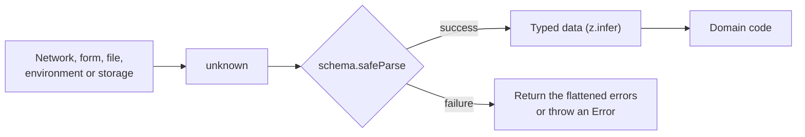

# TypeScript Runtime Validation and External Data

## Summary

TypeScript types disappear at run time, so a type annotation proves nothing about data that comes from outside the program. Treat every external value as `unknown`, parse it with a Zod schema at the boundary, and use the type that the schema infers. One schema then gives the validator and the type.

## Rules



### Validate at every boundary

- Validate each of these before the code uses them: an upstream API or CMS response, a request body, search parameters, `FormData`, cookies and headers, `localStorage`, `postMessage` data, a JSON file and the environment.
- Hold the value as `unknown` until the schema accepts it. Never write `as Foo` on external data, because the assertion checks nothing.
- Validate once, where the data enters. Trusted internal data does not need a second schema.
- Map the wire shape to the domain shape in the same place (rename fields, turn `null` into an absent property, parse dates). Components receive the domain type ([data access layer](../nextjs-convention/05-data-fetching-and-caching.md#where-to-fetch)).

### Use Zod

- Use Zod for every schema, on the server and in the browser: `import { z } from "zod"`. Zod has 221.6 million weekly downloads, against 15.7 million for Joi, 14.4 million for Valibot, 7.5 million for Yup and 1.4 million for ArkType, and the Next.js notes already use it ([forms](../nextjs-convention/06-mutations-and-forms.md#validation-and-errors)).
- When a client bundle must shrink, use `zod/mini` before you consider another library.
- Declare a schema next to the code that reads the data, and export the inferred type with `z.infer<typeof schema>`. Do not write the same shape as an `interface` as well.
- Use `z.unknown()` for a value that stays opaque. Never use `z.any()`.

### Validating data

- Call `parse` when invalid data is a fault: a bug or a broken upstream. It throws a `ZodError`, which reaches the nearest error boundary or handler ([error handling](09-error-handling.md)).
- Call `safeParse` when invalid data is a normal outcome, such as user input. It returns a union that you narrow with `result.success`.
- Pass the schema to a generic helper so that the schema carries the type. The helper below needs no `as` and no return-type-only generic.

```ts
import { z } from "zod";

const faqResponseSchema = z.object({
  data: z.array(z.object({ question: z.string(), answer: z.string() })),
});

export type FaqResponse = z.infer<typeof faqResponseSchema>;

export async function fetchJson<T>(
  schema: z.ZodType<T>,
  url: string,
  init?: RequestInit,
): Promise<T> {
  const response = await fetch(url, init);
  if (!response.ok) {
    throw new Error(`Request to ${url} failed with status ${response.status}`);
  }
  const body: unknown = await response.json();
  return schema.parse(body);
}

export function getFaqs(baseUrl: string): Promise<FaqResponse> {
  return fetchJson(faqResponseSchema, `${baseUrl}/faq`, {
    signal: AbortSignal.timeout(5_000),
  });
}
```

### Forms and user input

- Parse form input with `safeParse` and return the errors as a value. `z.flattenError(error)` gives `{ formErrors, fieldErrors }`, which is what a form needs.
- Do not call `error.flatten()` or `error.format()`. Zod 4 deprecates both methods in favour of the top-level `z.flattenError()` and `z.treeifyError()`. Use `z.prettifyError()` for a readable log line.
- Show the same messages next to the fields and in an `aria-live` region ([Next.js forms](../nextjs-convention/06-mutations-and-forms.md#validation-and-errors)).

```ts
import { z } from "zod";

const contactSchema = z.object({
  email: z.email(),
  message: z.string().min(10),
});

export interface ContactState {
  errors?: Record<string, string[] | undefined>;
  sent?: boolean;
}

export function parseContact(formData: FormData): ContactState {
  const parsed = contactSchema.safeParse(Object.fromEntries(formData));
  if (!parsed.success) {
    return { errors: z.flattenError(parsed.error).fieldErrors };
  }
  return { sent: true };
}
```

### Environment variables

- Parse `process.env` once, in one `server-only` module, and export the typed result. No other file reads `process.env`. Fail at start-up with the schema's error, not later with `undefined`.
- Next.js inlines `NEXT_PUBLIC_` variables where the code writes `process.env.NEXT_PUBLIC_NAME` literally. Read those names one by one in a separate module, and do not pass `process.env` to a schema in code that reaches the browser ([security](../nextjs-convention/10-security.md#environment-variables)).
- Existing code: move `process.env` reads into a module when you change them.

```ts
// lib/env.ts
import "server-only";
import { z } from "zod";

const envSchema = z.object({
  CMS_API_URL: z.url(),
  NODE_ENV: z.enum(["development", "test", "production"]).default("development"),
});

export const env = envSchema.parse(process.env);
```

## Sources and raw notes

Pages read on 2026-10-26:

- [Zod basics](https://zod.dev/basics), [error formatting](https://zod.dev/error-formatting) and [Zod 4 changelog](https://zod.dev/v4/changelog): `parse`, `safeParse`, `z.infer`, `z.flattenError`, `z.treeifyError`, `z.prettifyError`, `zod/mini`, and the deprecation of `.flatten()` and `.format()`. npm: `zod` is 4.6.7.
- npm weekly downloads (`api.npmjs.org`, 2026-10-16 to 2026-10-22): `zod` 221,643,257, `joi` 15,736,800, `valibot` 14,436,274, `yup` 7,451,643, `arktype` 1,445,087; `@sinclair/typebox` has 73,849,584 and `io-ts` 1,780,315.
- The Next.js [environment variables guide](https://nextjs.org/docs/app/guides/environment-variables) through [security](../nextjs-convention/10-security.md#environment-variables): the inlining of `NEXT_PUBLIC_` variables.
- The three code blocks compiled under the Next.js baseline of [tsconfig](03-tsconfig.md#baseline-for-a-nextjs-application) with TypeScript 5.9.3 and Zod 4.6.7, and they passed the lint config of [setup](02-project-setup-and-tooling.md#linting) without a finding. A run under `node --experimental-strip-types` printed `{"formErrors":[],"fieldErrors":{"email":["Invalid email address"],"message":["Too small: expected string to have >=10 characters"]}}` for a bad contact form, applied the `development` default, and threw a `ZodError` for an invalid URL.
- `process.env` reads counted in the syntax tree of both repositories on 2026-10-26.
