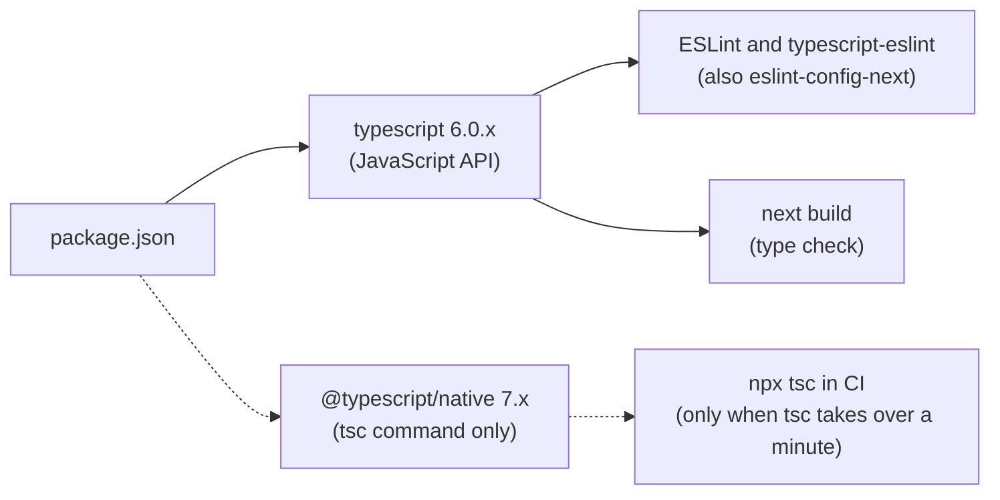

# TypeScript Project Setup and Tooling

## Summary

Every TypeScript project keeps a small toolchain: one TypeScript 6.0 compiler, a typed ESLint flat config, Prettier, and one script per check, all run in CI. Node.js runs TypeScript scripts directly through type stripping, and `tsx` covers what stripping cannot.

## Rules

### TypeScript versions

- Install TypeScript with an explicit range: `npm install -D typescript@~6.0.3`. A bare `npm install -D typescript` installs 7.0 today, because the npm `latest` tag is 7.0.2.
- Use a tilde range for `typescript`. A minor release can add errors to a clean build, so the range and the lock file hold the project on one minor version until a person upgrades it.
- Stay on 6.0 while typescript-eslint supports `>=4.8.4 <6.1.0`. TypeScript 7.0 is a native compiler without a JavaScript API, so typescript-eslint, and `eslint-config-next` with it, cannot load it. TypeScript 7.1 (beta on 2026-10-20) adds a new API.
- Run TypeScript 7 only side by side, and only when a full `tsc` run takes more than a minute. The TypeScript team's recipe keeps the 6.0 API under the name `typescript` and adds 7.0 under another name, so that `npx tsc` runs 7.0:

```json
{
  "devDependencies": {
    "@typescript/native": "npm:typescript@^7.0.2",
    "typescript": "npm:@typescript/typescript6@^6.0.2"
  }
}
```

- The 6.0 package provides an executable named `tsc6`. Use `tsc` (7.0) in CI and let the editor and the linter use the `typescript` alias.
- Expect 7.0 to report errors that 6.0 does not, and fix them before `tsc` 7 becomes the CI gate. A suppression comment can lose its effect when an error moves to another line ([upgrading](12-modern-typescript-by-release.md#upgrading)).
- Move `typescript` itself to 7.x when the [dependency versions page](https://typescript-eslint.io/users/dependency-versions) of typescript-eslint lists 7.x as supported, and then delete both aliases. Check the page when TypeScript 7.1 is final.



### Node.js and type packages

- Give `@types/node` the same major version as the production Node.js, in `engines` and in `.nvmrc` as well ([versions and runtime](../nextjs-conventions/02-project-setup-and-tooling.md#versions-and-runtime)). `create-next-app` writes `@types/node ^20`: change it to the runtime major.
- Keep `@types/react` and `@types/react-dom` on the React major version.
- Do not install an `@types/*` package for a library that ships its own types.

### Scripts

```json
{
  "scripts": {
    "typecheck": "tsc --noEmit",
    "lint": "eslint",
    "format:check": "prettier --check .",
    "test": "vitest run",
    "ci": "npm run typecheck && npm run lint && npm run format:check && npm test"
  }
}
```

- Next.js projects write `typecheck` as `next typegen && tsc --noEmit` and add `next build` to `ci` ([scripts](../nextjs-conventions/02-project-setup-and-tooling.md#scripts)).
- Run the checks in this order: type check, lint, format check, tests, build. Have the CI runner call `npm run ci` and nothing else.
- Include test files in the type check. A type error in a test fails the build.

### Linting

- Use an ESLint flat config with the typed typescript-eslint presets `recommendedTypeChecked` and `stylisticTypeChecked`, and turn on `projectService`. The typescript-eslint documentation suggests exactly this pair for a project with type checking, and it recommends typed linting strongly.
- Do not use the `strict` presets. The documentation calls them unstable under semantic versioning and suggests them only when a nontrivial share of the developers is highly proficient in TypeScript.
- Add `@typescript-eslint/no-non-null-assertion` as an error. No preset turns it on outside `strict`.
- A Next.js project keeps `eslint-config-next` and adds the typed presets after it:

```js
// eslint.config.mjs
import { defineConfig, globalIgnores } from "eslint/config";
import nextVitals from "eslint-config-next/core-web-vitals";
import nextTs from "eslint-config-next/typescript";
import tseslint from "typescript-eslint";

export default defineConfig([
  ...nextVitals,
  ...nextTs,
  {
    files: ["**/*.{ts,tsx,mts}"],
    extends: [
      tseslint.configs.recommendedTypeChecked,
      tseslint.configs.stylisticTypeChecked,
    ],
    languageOptions: { parserOptions: { projectService: true } },
    rules: { "@typescript-eslint/no-non-null-assertion": "error" },
  },
  globalIgnores([".next/**", "out/**", "build/**", "next-env.d.ts"]),
]);
```

- A project without Next.js uses the same block after `js.configs.recommended`:

```js
// eslint.config.mjs
import js from "@eslint/js";
import { defineConfig } from "eslint/config";
import tseslint from "typescript-eslint";

export default defineConfig({
  files: ["**/*.ts"],
  extends: [
    js.configs.recommended,
    tseslint.configs.recommendedTypeChecked,
    tseslint.configs.stylisticTypeChecked,
  ],
  languageOptions: { parserOptions: { projectService: true } },
  rules: { "@typescript-eslint/no-non-null-assertion": "error" },
});
```

- Put `eslint-config-prettier/flat` last in either config, so that ESLint and Prettier do not fight ([linting and formatting](../nextjs-conventions/02-project-setup-and-tooling.md#linting-and-formatting)).
- The presets already forbid `any`, floating promises, `@ts-ignore`, `require()` and throwing non-errors. Disable a rule only with a comment that gives the reason.
- Write `@ts-expect-error` with a description, because `ban-ts-comment` rejects it without one. `@ts-ignore` and `@ts-nocheck` are banned.

### Adopting the lint config in an existing project

- Add the config, run `npx eslint --fix --suppress-all`, and commit the `eslint-suppressions.json` file that it writes. ESLint then reports only new violations, and the team fixes the suppressed ones file by file.
- ESLint suppresses only rules that are set to `error`. Run `npx eslint --prune-suppressions` after a clean-up, so that the file shrinks.
- Expect many findings in a codebase that never ran these rules. `--fix --suppress-all` writes a suppressions file for the errors, and warnings stay, because ESLint suppresses only errors.

### Formatting

- Format with Prettier 3 and its default options, with no config file.
- An existing project keeps its settings until it moves to Prettier 3 in its own change.

### Running TypeScript on Node.js

- Run a script or a small tool directly with `node script.ts`. Type stripping is on by default from Node.js 22.18 and 24.3, and it is stable from 24.12 and 25.2. Node.js removes the types and runs the rest, so it checks nothing: `tsc --noEmit` is the check.
- Stripping needs erasable syntax, `.ts` extensions in relative imports and `import type` for types. It ignores `tsconfig.json`, so `paths` do not work, and it does not run `.tsx` files ([tsconfig](03-tsconfig.md#baseline-for-a-nodejs-project)).
- Use `tsx` when a script needs what stripping lacks (path aliases, JSX, `enum`). Do not add `ts-node`: `tsx` has more than twice its weekly downloads, and the Node.js documentation names `tsx` as its example for full TypeScript support.
- Use the bundler settings in `tsconfig.json` for a script that runs under `tsx`, as the TypeScript handbook says.

```ts
// scripts/greet.ts
import { greet } from "./format.ts";
import type { Greeting } from "./format.ts";

const greeting: Greeting = { name: process.argv[2] ?? "world", shout: true };
console.log(greet(greeting));
```

### Editor

- Select the workspace TypeScript version in the editor (in VS Code: "TypeScript: Select TypeScript Version", then "Use Workspace Version"), so that the editor and CI report the same errors.

## Sources and raw notes

Pages read on 2026-10-26:

- [Announcing TypeScript 7.0](https://devblogs.microsoft.com/typescript/announcing-typescript-7-0/): the side-by-side recipe, the `tsc6` executable, no API in 7.0. [TypeScript 7.1 Beta](https://devblogs.microsoft.com/typescript/announcing-typescript-7-1-beta/): the new API.
- npm registry: `typescript` `latest` is 7.0.2; `@typescript/typescript6` is 6.0.2 with the `tsc6` executable; `typescript-eslint@8.72.0` has the peer range `typescript >=4.8.4 <6.1.0`; `eslint-config-next@16.4.3` depends on `typescript-eslint ^8.56.0`; `prettier` is 3.9.10.
- [typescript-eslint shared configs](https://typescript-eslint.io/users/configs) and [typed linting](https://typescript-eslint.io/getting-started/typed-linting): the suggested presets, `projectService`, the `strict` warnings, and Prettier for formatting. The preset rule lists come from `typescript-eslint@8.72.0` (`recommended-type-checked`, `stylistic-type-checked`, `strict-type-checked`).
- [ESLint bulk suppressions](https://eslint.org/docs/latest/use/suppressions): `--suppress-all`, `--prune-suppressions`, and the rule that only `error` rules are suppressed.
- [Node.js TypeScript documentation](https://nodejs.org/api/typescript.html) (v26.12.1): the version history of type stripping, the unsupported syntax, `tsx` as the example for full support.
- [TypeScript handbook: choosing compiler options](https://www.typescriptlang.org/docs/handbook/modules/guides/choosing-compiler-options.html): the `tsx` section.
- npm weekly downloads (`api.npmjs.org`, 2026-10-16 to 2026-10-22): `tsx` 64.5 million, `ts-node` 27.8 million.
- Checked with ESLint 9.39.5, typescript-eslint 8.72.0 and TypeScript 5.9.3 in a scratch project: the sample config ran and reported `no-floating-promises`, `no-explicit-any`, `consistent-type-definitions` and `no-non-null-assertion` on a sample, and `greet.ts` ran under `node --experimental-strip-types` on Node.js 22.14.0. The sample config ran without `eslint-config-prettier`.
- Checked on 2026-10-26 in a scratch project, with TypeScript 6.0.3, ESLint 9.39.5, typescript-eslint 8.72.0 and eslint-config-next 16.4.3: `--fix --suppress-all` followed by a plain run ended with no errors. The alias recipe installed `typescript@7.0.2` as `@typescript/native` and `@typescript/typescript6@6.0.2` as `typescript`, which depends on `typescript@^6` (6.0.3 that day). `npx tsc` printed 7.0.2, `npx tsc6` printed 6.0.3, `require("typescript").version` returned 6.0.3, and `node_modules/.bin/tsserver` came from the 6.0 compiler.
