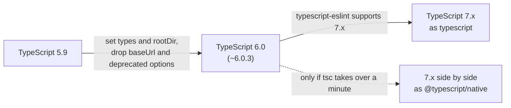

# Modern TypeScript by Release

## Summary

This note lists what each TypeScript release added and which old idiom each addition replaces. Write new code with the modern idiom, replace the old idiom when you touch the line, and upgrade one minor version at a time. TypeScript 6.0 is the version to run today, and TypeScript 7 follows when typescript-eslint supports it.

## Rules

### Release timeline

| Version | Released | What matters for these conventions |
| --- | --- | --- |
| 5.0 | 2023-03-16 | Standard decorators. `const` type parameters. Every `enum` is a union enum. `--moduleResolution bundler` and `--verbatimModuleSyntax`. Several files in `extends`. |
| 5.1 | 2023-06-01 | Functions that return `undefined` need no `return`. Unrelated types for a getter and its setter. |
| 5.2 | 2023-08-25 | `using` declarations for explicit resource management. Decorator metadata. |
| 5.3 | 2023-11-20 | Import attributes (`with { type: "json" }`). `switch (true)` narrowing. |
| 5.4 | 2024-03-06 | The `NoInfer` utility type. Narrowing survives in closures after the last assignment. Types for `Object.groupBy` and `Map.groupBy`. |
| 5.5 | 2024-06-20 | Inferred type predicates. `--isolatedDeclarations`. Syntax checking of regular expressions. Types for the new `Set` methods. |
| 5.6 | 2024-09-09 | Errors for checks that are always true or always false. Iterator helper types. `--noUncheckedSideEffectImports` and `--noCheck`. |
| 5.7 | 2024-11-22 | Errors for variables that are never initialised. `--rewriteRelativeImportExtensions`. `--target es2024`. Validated JSON imports under `nodenext`. |
| 5.8 | 2025-02-28 | `--erasableSyntaxOnly`. `--module node18`. `require()` of ES modules under `nodenext`. Checked branches in return expressions. |
| 5.9 | 2025-08-01 | A minimal `tsc --init`. `import defer`. `--module node20`. |
| 6.0 | 2026-03-23 | The last JavaScript-based release. New defaults (`strict`, `module: esnext`, `types: []`) and removed options. `#/` subpath imports. Types for `Temporal`, `Map.getOrInsert` and `RegExp.escape`. `--target es2025`. |
| 7.0 | 2026-07-08 | The native compiler, 8 to 12 times faster on full builds. No JavaScript API. `--checkers`, `--builders` and `--singleThreaded`. A reworked JavaScript mode. |
| 7.1 | beta 2026-10-20 | A new API with several entry points. `--target es2026`. Import attributes in ambient modules. Source phase imports. A release candidate is due about a month later. |

The TypeScript team plans a new feature release every three to four months.

### Old idiom, modern idiom

| Old | Modern | Since |
| --- | --- | --- |
| `enum Status { ... }` | An `as const` array and a union type ([types](04-types-and-type-design.md#model-alternatives-with-unions)) | `--erasableSyntaxOnly` in 5.8 |
| `import x = require("x")`, `export =` | `import x from "x"`, `export` | 5.8 |
| A `namespace` with code, or the `module` keyword for a namespace | ES modules. The `module` keyword is an error since 6.0 | 6.0 |
| `<Type>value` | `value as Type`, or better a type guard | 5.8 |
| `experimentalDecorators` | Standard decorators | 5.0 |
| `// @ts-ignore` | `// @ts-expect-error` with a description | 3.9 |
| `any` | `unknown` and narrowing | 3.0 |
| `type Props = { ... }` | `interface Props { ... }` | style |
| A hand-written type guard for `filter` | An inferred type predicate | 5.5 |
| `import data from "./a.json" assert { type: "json" }` | `with { type: "json" }` (the `assert` form is an error since 6.0) | 5.3 |
| `moduleResolution: node` (node10) | `bundler` or `nodenext` | deprecated in 6.0, removed in 7.0 |
| `baseUrl` with `paths` | `paths` with the folder in each entry | deprecated in 6.0, removed in 7.0 |
| `esModuleInterop: false`, `alwaysStrict: false` | The only behaviour | deprecated in 6.0, removed in 7.0 |
| `target: es5`, `downlevelIteration`, `outFile` | A modern `target` and a bundler | deprecated in 6.0, removed in 7.0 |
| `lib: ["dom", "dom.iterable"]` | `lib: ["dom"]` | 6.0 |
| `ts-node` | Node.js type stripping, or `tsx` ([setup](02-project-setup-and-tooling.md#running-typescript-on-nodejs)) | Node.js 22.18 |
| `sort`, `splice` and `reverse` on shared arrays | `toSorted`, `toSpliced` and `with` | ES2023 library |

### Upgrading

- Upgrade one minor version in its own pull request, and read the "breaking" or "notable behavioural changes" section of the release notes first.
- Moving from 5.9 to 6.0:
  - Set `"typescript": "~6.0.3"` and run `npm run typecheck` and `npm run lint`.
  - Set `types` explicitly in a Node.js project (`["node"]`). A Next.js app needs no entry, because its generated types load the Node.js types.
  - Set `rootDir` when the project emits files. Remove `baseUrl` and put its folder into every `paths` entry. The experimental `@andrewbranch/ts5to6` tool does both (these checks did not run it).
  - Treat `ignoreDeprecations: "6.0"` as a short bridge, and remove it before TypeScript 7.0, which removes the deprecated options.
  - With a `tsconfig.json` in the folder, `tsc file.ts` stops with TS5112. Run `tsc -p .`, or pass `--ignoreConfig`.
- Moving from 6.0 to 7.x: wait until typescript-eslint supports 7.x, then set `typescript` to the 7.x range and delete the aliases ([TypeScript versions](02-project-setup-and-tooling.md#typescript-versions)). Run `tsc` 7 side by side first and compare its errors with the 6.0 run, because code that is clean under 6.0 can still fail under 7.0. A `// @ts-ignore` above a call that spans several lines can stop covering the error, because TypeScript 7.0 can report it on a later line than 6.0 does. Fix the type instead of suppressing the error, because a suppression comment covers only the next line.
- Compare the number of type errors and the lint findings before and after each upgrade. `--stableTypeOrdering` in 6.0 makes the type ordering match 7.0, which helps when a diff of declaration files is noisy. It can slow the check by up to 25 percent, so do not keep it on.
- Check these dates when you plan the 7.x move: TypeScript 7.1 has a beta (2026-10-20), a release candidate is due in about a month, and the final release follows shortly after.

## Sources and raw notes

Pages read on 2026-10-26:

- [Announcing TypeScript 7.0](https://devblogs.microsoft.com/typescript/announcing-typescript-7-0/) (2026-07-08), [6.0](https://devblogs.microsoft.com/typescript/announcing-typescript-6-0/) (2026-03-23), [7.1 Beta](https://devblogs.microsoft.com/typescript/announcing-typescript-7-1-beta/) (2026-10-20) and the [blog feed](https://devblogs.microsoft.com/typescript/feed/) (5.9 announced 2025-08-01).
- The release notes of TypeScript 5.0 to 5.9 in the `TypeScript-Website` repository (section headings for each release), and the GitHub releases of `microsoft/TypeScript` for the dates of 5.0 to 5.8 (the first stable tag of each minor version). The GitHub dates of 5.9 are not reliable, so the table uses the blog date.
- [Node.js TypeScript documentation](https://nodejs.org/api/typescript.html) (v26.12.1): type stripping history, and the `--experimental-transform-types` flag that Node.js 26.0.0 removed.
- npm registry: `typescript` `latest` is 7.0.2 and `beta` is 7.1.0-beta.
- TypeScript 6.0.3 and 7.0.2 were installed in scratch projects outside the repositories on 2026-10-26. The checks of the defaults, the deprecated options, the baselines and the alias recipe are in [tsconfig](03-tsconfig.md#changes-in-typescript-60-and-70) and [setup](02-project-setup-and-tooling.md#typescript-versions).
- The same projects confirmed these rows of the tables: `RegExp.escape`, `Map.prototype.getOrInsert` and `Temporal` type-check under 6.0.3 and 7.0.2 but not under 5.9.3, `module Foo {}` (TS1540) and `assert { type: "json" }` (TS2880) are errors in both new versions, `lib: ["dom"]` includes the iterable DOM types (a `for...of` over `querySelectorAll` fails under 5.9.3 only), `#/` subpath imports resolve under 6.0.3 and 7.0.2 but not under 5.9.3, 6.0.3 accepts `--stableTypeOrdering` (`--help --all` does not list it), the help of 7.0.2 lists `--checkers`, `--builders` and `--singleThreaded`, and npm has `@andrewbranch/ts5to6` 1.1.1 ("CLI to migrate TypeScript config files to be compatible with TypeScript 6.0").
- A full `tsc --noEmit` ran several times faster under 7.0.2 than under 6.0.3 in the projects measured for these notes, medians of five runs. The effect of `--stableTypeOrdering`, the `ts5to6` migration and every 7.1 item rest on the release posts.
